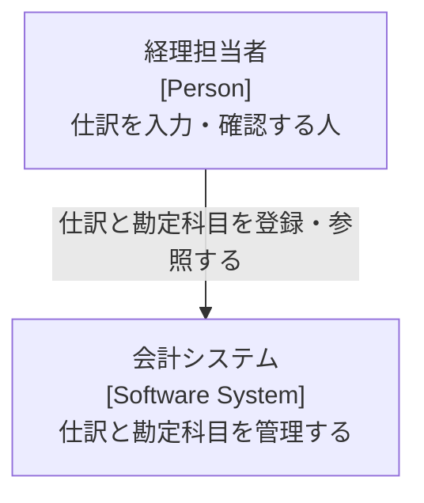
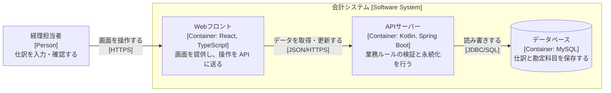
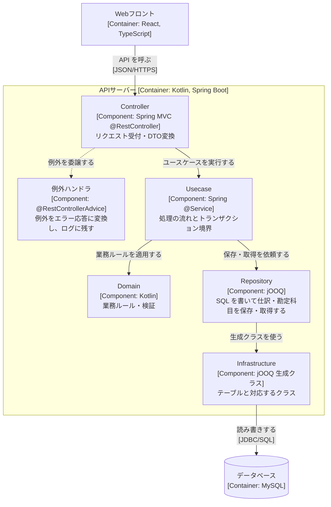

# C4 モデル

会計システムの構造を C4 モデルのレベル 1〜3 で示す。図は Mermaid で書く。

## 凡例

- 要素は「名前 / `[種別: 技術]` / 説明」の順に書く。
- 矢印は呼び出しを始める側から受ける側へ向ける。データが流れる向きではない。
- 関係線のラベルは呼び出しの目的を表す。`[ ]` 内はプロトコルなどの技術を表す。
- 破線は例外の委譲を表す。

## レベル 1: システムコンテキスト

誰がこのシステムを使い、周囲に何があるかを示す。

- 外部システムはない。認証と外部連携はスコープ外。

## レベル 2: コンテナ

会計システムを、実行単位ごとに分けて示す。

- Web フロントはブラウザ上で動く SPA。画面操作の状態管理と入力の事前検証を担う。
- API サーバーは業務ルールの検証と永続化を担う。入力値の検証はフロントに依存せず、サーバー側でも必ず行う。
- データベースは仕訳と勘定科目を保存する。
- `HTTPS` は本番想定の表記。ローカル環境では HTTP になる。

## レベル 3: API サーバーのコンポーネント

API サーバーの内部を、レイヤごとに分けて示す。

- Controller は薄く保つ。リクエストの受付、DTO の変換、レスポンスの返却だけを行う。
- 依存は Controller → Usecase → Domain / Repository の一方向のみ。
- 例外は例外ハンドラで共通処理する。
- 永続化は jOOQ を使う（`decisions.md` の論点 8）。スキーマは Flyway のマイグレーションを正とし、そこから生成クラスを作る。
- domain モデルと jOOQ の生成クラスは分ける（`decisions.md` の論点 6）。そのため Infrastructure を独立したコンポーネントとして描いている。

## 未確定の点

- domain と jOOQ 生成クラスの変換をどのコンポーネントが担うかは、アーキテクチャ設計書で決める。決まったらレベル 3 の「生成クラスを使う」の線を直す。
- Repository のインターフェースをどのレイヤに置くかも、アーキテクチャ設計書で決める。jOOQ では Spring Data のインターフェースを使わないため、置き場所を選べる。
