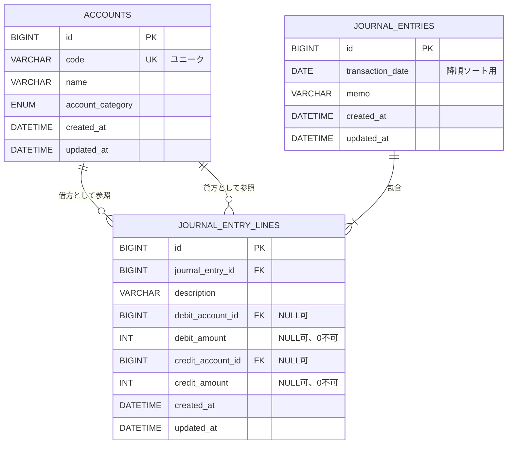

# データモデル設計書

作成日：2026-11-13

## 概要

会計システムのデータベース設計。3つのテーブルで構成：
1. **accounts** — 勘定科目マスタ
2. **journal_entries** — 仕訳
3. **journal_entry_lines** — 仕訳行

## テーブル設計

### 1. accounts（勘定科目マスタ）

勘定科目の定義を保持。1つの勘定科目マスタが複数の仕訳行から参照される。

**目的:** 仕訳行で使用できる勘定科目を一元管理し、削除時の整合性を保つ。

| カラム名 | 型 | NOT NULL | ユニーク | 主キー | 説明 |
|---------|-----|---------|--------|--------|------|
| id | BIGINT | ✓ | - | ✓ | 自動採番の勘定科目ID |
| code | VARCHAR(20) | ✓ | ✓ | - | 勘定科目コード（例：110,120,210,310） |
| name | VARCHAR(20) | ✓ | - | - | 勘定科目名（例：現金、普通預金） |
| account_category | ENUM('DEBIT', 'CREDIT') | ✓ | - | - | 勘定科目のカテゴリ（常に「借方」か「貸方」） |
| created_at | DATETIME | ✓ | - | - | 作成日時（Asia/Tokyo） |
| updated_at | DATETIME | ✓ | - | - | 更新日時（Asia/Tokyo） |

**制約:**
- PRIMARY KEY (id)
- UNIQUE (code) — コード重複を防ぐ
- CHECK (account_category IN ('DEBIT', 'CREDIT'))

**インデックス:**
- code（一意性を保証、検索高速化）

---

### 2. journal_entries（仕訳）

仕訳の基本情報を保持。1つの仕訳が複数の仕訳行をまとめる。

**目的:** 取引日とメモを一元管理し、仕訳行との1対多の親テーブルとなる。

| カラム名 | 型 | NOT NULL | ユニーク | 主キー | 説明 |
|---------|-----|---------|--------|--------|------|
| id | BIGINT | ✓ | - | ✓ | 自動採番の仕訳ID |
| transaction_date | DATE | ✓ | - | - | 取引日（年月日、タイムゾーン Asia/Tokyo） |
| memo | VARCHAR(200) | - | - | - | メモ（任意、200文字まで） |
| created_at | DATETIME | ✓ | - | - | 作成日時（Asia/Tokyo） |
| updated_at | DATETIME | ✓ | - | - | 更新日時（Asia/Tokyo） |

**制約:**
- PRIMARY KEY (id)
- CHECK (memo IS NULL OR LENGTH(memo) <= 200)

**インデックス:**
- transaction_date （一覧取得時の降順ソート高速化）
- (transaction_date DESC, id DESC) — 複合インデックス（表示順で使用）

---

### 3. journal_entry_lines（仕訳行）

仕訳の明細行。1つの仕訳が1行以上の仕訳行をまとめる。

**目的:** 借方・貸方の勘定科目と金額を保持。仕訳の編集時は全置換される。

| カラム名 | 型 | NOT NULL | ユニーク | 主キー | 説明 |
|---------|-----|---------|--------|--------|------|
| id | BIGINT | ✓ | - | ✓ | 自動採番の仕訳行ID |
| journal_entry_id | BIGINT | ✓ | - | - | 親仕訳のID（外部キー） |
| description | VARCHAR(100) | - | - | - | 摘要（任意、100文字まで） |
| debit_account_id | BIGINT | - | - | - | 借方勘定科目のID（外部キー）。金額がある場合は必須 |
| debit_amount | INT | - | - | - | 借方金額（正の整数。0不可。金額がある場合は必須） |
| credit_account_id | BIGINT | - | - | - | 貸方勘定科目のID（外部キー）。金額がある場合は必須 |
| credit_amount | INT | - | - | - | 貸方金額（正の整数。0不可。金額がある場合は必須） |
| created_at | DATETIME | ✓ | - | - | 作成日時（Asia/Tokyo） |
| updated_at | DATETIME | ✓ | - | - | 更新日時（Asia/Tokyo） |

**制約:**
- PRIMARY KEY (id)
- FOREIGN KEY (journal_entry_id) REFERENCES journal_entries(id) ON DELETE CASCADE
  - 仕訳削除時、その仕訳行も自動削除される
- FOREIGN KEY (debit_account_id) REFERENCES accounts(id) ON DELETE RESTRICT
  - 勘定科目削除時、その勘定科目が使用中の仕訳行があれば削除を禁止
- FOREIGN KEY (credit_account_id) REFERENCES accounts(id) ON DELETE RESTRICT
  - 勘定科目削除時、その勘定科目が使用中の仕訳行があれば削除を禁止
- CHECK (description IS NULL OR LENGTH(description) <= 100)
- CHECK (debit_amount IS NULL OR debit_amount > 0)
- CHECK (credit_amount IS NULL OR credit_amount > 0)
- CHECK ((debit_account_id IS NOT NULL) = (debit_amount IS NOT NULL))
  - 借方：勘定科目と金額は両方あるか、両方NULLか
- CHECK ((credit_account_id IS NOT NULL) = (credit_amount IS NOT NULL))
  - 貸方：勘定科目と金額は両方あるか、両方NULLか

**インデックス:**
- FOREIGN KEY (journal_entry_id) — 親仕訳の行取得時の高速化
- FOREIGN KEY (debit_account_id) — 勘定科目削除時の参照確認高速化
- FOREIGN KEY (credit_account_id) — 勘定科目削除時の参照確認高速化

---

## 関係図（ER図）

---

## 設計の理由

### 1. 仕訳行の形（暫定）

仕訳行1件に借方と貸方の両方を保持する設計。

**理由:**
- 要件の例 "借方100円/貸方50円" と "借方空/貸方50円" を同一仕訳内に共存できる
- テーブル設計がシンプル（借方・貸方の列が対になるため）
- 「摘要」は行ごとに異なる可能性があるため、1行に集約

**注:** 実装時に要件が変わる可能性がある（メンターとの相談待ち）

### 2. 勘定科目の削除ポリシー

使用中の勘定科目は削除不可（外部キー ON DELETE RESTRICT）。

**理由:**
- 過去の仕訳行が勘定科目を参照していると、削除するとデータ整合性が崩れる
- 監査証跡としても、歴史的データを消さない方がよい
- 例外的に無効化したい場合は、別途「無効フラグ」を持つ仕様に変更可

### 3. 仕訳行の編集と全置換

仕訳編集時は既存の仕訳行を全削除し、新しい行を一括追加する。

**理由:**
- 行の追加・削除・更新をすべて同じロジックで扱える
- 実装が単純（差分検出不要）
- 代償：仕訳行IDはその都度変わる（外部から参照不可）

### 4. 複合インデックス (transaction_date DESC, id DESC)

一覧取得で「取引日降順、同日はID降順」をソート効率化。

**理由:**
- 一覧クエリが `ORDER BY transaction_date DESC, id DESC` になるため
- インデックスがあれば、データベース側でソート済みで返却可

### 5. 外部キー制約の選択

- `journal_entries → journal_entry_lines`: ON DELETE CASCADE
  - 仕訳を削除すれば、その仕訳行も自動削除
  
- `journal_entry_lines → accounts`: ON DELETE RESTRICT
  - 勘定科目は複数の仕訳行から参照されうるため、削除を許さない

---

## 注意点

1. **タイムゾーン:** すべて Asia/Tokyo（アプリケーションで統一）
2. **金額の型:** INT（最大約21億円まで対応。小数不要なため）
3. **文字列長:** VARCHAR(20) など上限を明示（バリデーション要件と対応）
4. **NULL の扱い:** 金額は「勘定科目がないならNULL」という制約で表現

---

## マイグレーション（Flyway）

このテーブル定義を Flyway マイグレーションファイル（例：V1__init_schema.sql）として実装。
jOOQ はこのスキーマから生成クラスを自動生成する。

