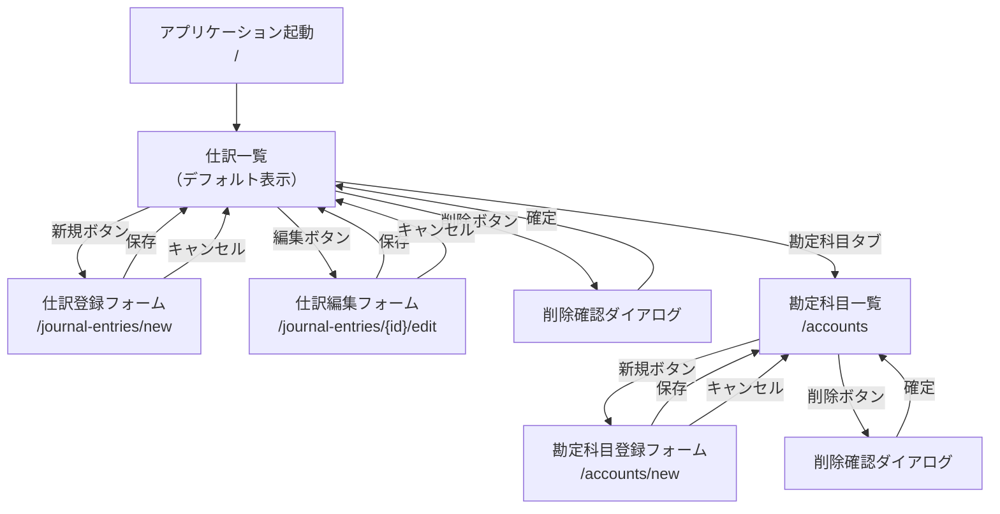

# 画面設計書

作成日：2026-11-13  
参照：`02-api-design.md`

## 概要

会計システムは 2 つのドメインで 5 画面構成。

| 画面 | URL | 機能 | 備考 |
|------|-----|------|------|
| 仕訳一覧 | `/` | 仕訳を一覧表示、編集・削除へ遷移 | デフォルトランディング |
| 仕訳登録 | `/journal-entries/new` | 新規仕訳を作成 | 一覧の「新規」ボタンから遷移 |
| 仕訳編集 | `/journal-entries/{id}/edit` | 既存仕訳を編集 | 一覧の「編集」ボタンから遷移 |
| 勘定科目一覧 | `/accounts` | 勘定科目を一覧表示、削除へ | 仕訳一覧からタブで遷移 |
| 勘定科目登録 | `/accounts/new` | 新規勘定科目を登録 | 勘定科目一覧の「新規」ボタンから遷移 |

計 **5 画面**（仕訳1系統、勘定科目1系統）

---

## 画面遷移フロー



---

## 1. 仕訳一覧画面

**URL:** `/`  
**主要機能:** 仕訳を一覧表示、操作ボタン（編集・削除）

### スクリーンショット

[ここにUIのスクリーンショットを貼付]

### 表示項目

**仕訳ごと：**
- 取引日（YYYY-MM-DD形式）
- メモ

**仕訳行ごと：**
- 摘要（あれば）
- 借方勘定科目コード、借方金額
- 矢印 `←→`
- 貸方勘定科目コード、貸方金額

### 操作ボタン

- **新規作成:** 仕訳登録画面へ
- **編集:** 当該仕訳を編集画面へ
- **削除:** 削除確認ダイアログを表示 → 削除実行 → 一覧から即時削除

### 状態管理

- **ローディング:** 一覧取得中は「読み込み中...」を表示
- **エラー:** API エラー時は「データ取得に失敗しました。再度お試しください」
- **空状態:** 仕訳がない場合は「仕訳がありません。新規作成から登録してください」

---

## 2. 仕訳登録画面

**URL:** `/journal-entries/new`  
**主要機能:** 新規仕訳を作成（取引日、メモ、仕訳行）

### スクリーンショット

[ここにUIのスクリーンショットを貼付]

### フォーム状態管理

**① 初期状態**
- 取引日：今日
- メモ：空
- 仕訳行：1行（すべて空）

**② 入力途中**
- 各フィールドの値を React state で管理
- 行追加・削除時に state を更新
- 他の行の入力は消えない（安定した状態管理）

**③ 保存中**
- 「保存」ボタンを disabled に
- 「保存中...」と表示

**④ 保存完了**
- 自動的に仕訳一覧画面へ遷移

**⑤ エラー発生**
- エラー表示エリアにメッセージを表示
- 保存ボタンは enabled のまま（ユーザーが修正できるように）

### バリデーション（フロント）

**リアルタイムバリデーション:**
- 取引日：日付形式の確認
- メモ：200文字超過を警告
- 摘要：100文字超過を警告
- 金額：正の整数のみ（0を含まない）

**保存時バリデーション:**
- 全項目の必須チェック
- 勘定科目の存在確認（セレクタから選択したもので確認可能）
- 貸借一致チェック（仕訳全体で借方合計 = 貸方合計）

---

## 3. 仕訳編集画面

**URL:** `/journal-entries/{id}/edit`  
**主要機能:** 既存仕訳を編集

仕訳登録と同じ構成。相違点：
- タイトル：「仕訳編集」
- 初期値：既存仕訳のデータをフォームに展開
- 保存時：PUT エンドポイントを呼び出す（仕訳行は全置換）

### 動作

- 画面読み込み時に GET `/api/journal-entries/{id}` を呼び出し、既存データをフォームに展開
- 編集後、保存時に PUT `/api/journal-entries/{id}` を呼び出し
- 仕訳行は全置換される（削除・追加・更新が1つのロジックで処理される）

---

## 4. 勘定科目一覧画面

**URL:** `/accounts`  
**主要機能:** 勘定科目を一覧表示、削除

### スクリーンショット

[ここにUIのスクリーンショットを貼付]

### 表示項目

| 列 | 説明 |
|---|---|
| コード | 勘定科目のコード（例：110, 120） |
| 名前 | 勘定科目の名前（例：現金、普通預金） |
| 貸借区分 | 「借方」または「貸方」 |
| 操作 | 「削除」ボタン |

### 表示項目

- コード
- 名前
- 貸借区分（借方 or 貸方）
- 削除ボタン

### 操作ボタン

- **新規作成:** 勘定科目登録画面へ
- **削除:** 削除確認ダイアログを表示 → 削除実行

### 状態管理

- **ローディング:** 「読み込み中...」を表示
- **エラー:** 「データ取得に失敗しました」
- **空状態:** 「勘定科目がありません」

---

## 5. 勘定科目登録画面

**URL:** `/accounts/new`  
**主要機能:** 新規勘定科目を登録

### スクリーンショット

[ここにUIのスクリーンショットを貼付]

### フォーム項目

- **コード:** テキスト入力（20文字制限）
- **名前:** テキスト入力（20文字制限）
- **貸借区分:** ラジオボタン（借方 / 貸方）

### バリデーション（フロント）

- コード：必須、20文字超過を警告
- 名前：必須、20文字超過を警告
- 貸借区分：必須、デフォルト値なし（ユーザーが選択）

### 保存時バリデーション

- 全項目の必須チェック
- サーバー側：コード重複チェック（409 Conflict → エラー表示）

---

## 6. 削除確認ダイアログ

### スクリーンショット

[ここにUIのスクリーンショットを貼付]

### ダイアログ仕様

**仕訳削除ダイアログ:**
- タイトル：「削除確認」
- メッセージ：「この仕訳を削除しますか？」
- 削除対象情報：取引日とメモを表示
- 警告文：赤色で「この操作は取り消せません」
- ボタン：「キャンセル」「削除」

**勘定科目削除ダイアログ:**
- タイトル：「削除確認」
- メッセージ：「この勘定科目を削除しますか？」
- 削除対象情報：コードと名前を表示
- 注記文：「この勘定科目が仕訳で使用中の場合は削除できません」
- ボタン：「キャンセル」「削除」

---

## コンポーネント責務（React）

### 共通コンポーネント

| コンポーネント | 責務 |
|--------------|------|
| `ErrorAlert` | エラーメッセージを表示（フロントエンドエラー、API エラー） |
| `LoadingSpinner` | ローディング状態を表示（一覧取得中など） |
| `ConfirmDialog` | 削除確認、アクション確認用ダイアログ |
| `FormField` | ラベル + 入力フィールドの組み合わせ |

### 仕訳系コンポーネント

| コンポーネント | 責務 |
|--------------|------|
| `JournalEntryList` | 仕訳一覧表示 |
| `JournalEntryForm` | 仕訳登録・編集フォーム（取引日、メモ、行テーブル） |
| `JournalEntryLineTable` | 仕訳行の追加・削除・編集テーブル |
| `JournalEntryLineRow` | 仕訳行1行分（摘要、借方、貸方） |
| `AccountSelector` | 勘定科目セレクタ（ドロップダウン） |

### 勘定科目系コンポーネント

| コンポーネント | 責務 |
|--------------|------|
| `AccountList` | 勘定科目一覧表示 |
| `AccountForm` | 勘定科目登録フォーム |

---

## フロントエンド状態管理方針

### コンポーネント State（React）

**各フォーム画面で管理:**
```javascript
const [formData, setFormData] = useState({
  transactionDate: '',
  memo: '',
  lines: [{ description: '', debitAccountId: null, ... }]
});

const [errors, setErrors] = useState({});
const [isLoading, setIsLoading] = useState(false);
const [apiError, setApiError] = useState(null);
```

### API エラー時の処理フロー

| エラー種別 | ステータス | フロント処理 |
|-----------|----------|----------|
| バリデーションエラー | 400 | フィールド単位でエラーを errors に格納 → 画面上部に一覧表示 |
| ビジネスロジックエラー | 409 | ユーザーが理解できるメッセージを表示（例：「この勘定科目は使用中です」） |
| リソース未検出 | 404 | 「データが見つかりません」と表示、一覧へ戻す |
| 予期しないエラー | 500 | 汎用メッセージ「予期しないエラーが発生しました」を表示、サーバーログに詳細を記録 |
| ネットワークエラー | - | 「通信に失敗しました。再度お試しください」 |

---

## UI/UX上の留意点

1. **ボタンの無効化:** API 呼び出し中は「保存」「削除」ボタンを disabled に（二重送信防止）
2. **フォーカス管理:** エラー発生時にエラー表示エリアまでスクロール
3. **確認ダイアログ:** 削除操作は必ず確認ダイアログを表示（誤操作防止）
4. **勘定科目セレクタ:** 「未選択」を NULL と扱う（借方・貸方が片側だけの場合）
5. **ローディング表示:** 最初は全体に loading spinner、その後画面要素を表示
6. **エラー表示:** 赤色で目立たせ、フィールドごとに吹き出しか色分け表示
