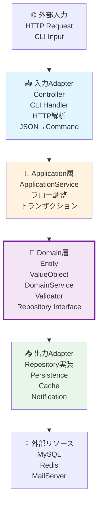
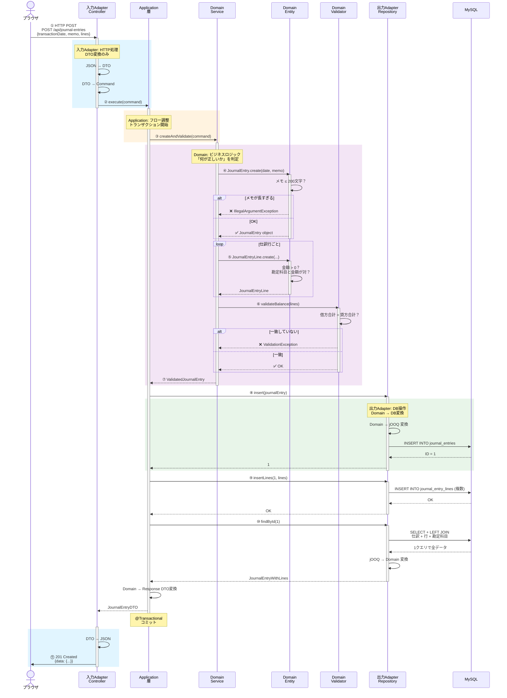
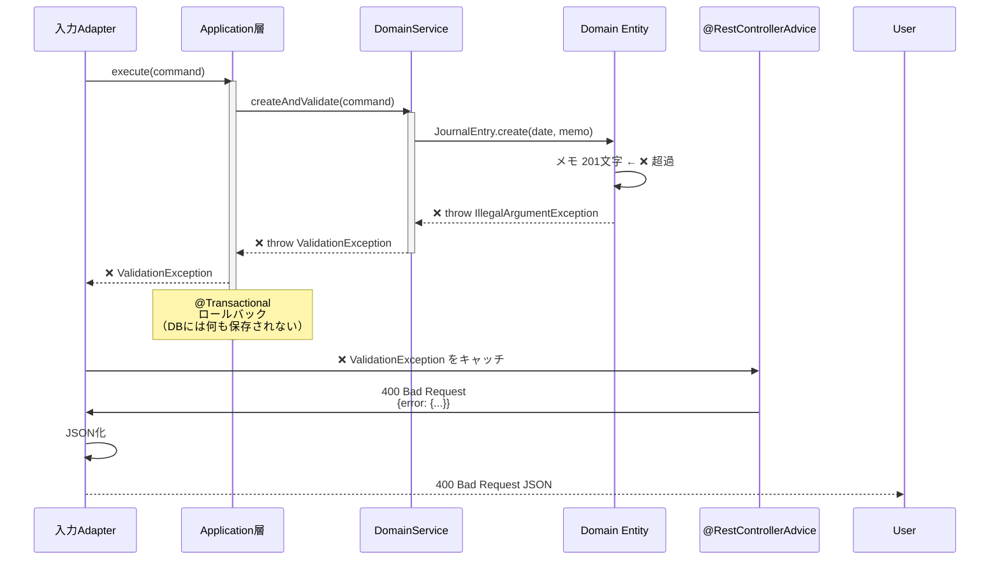
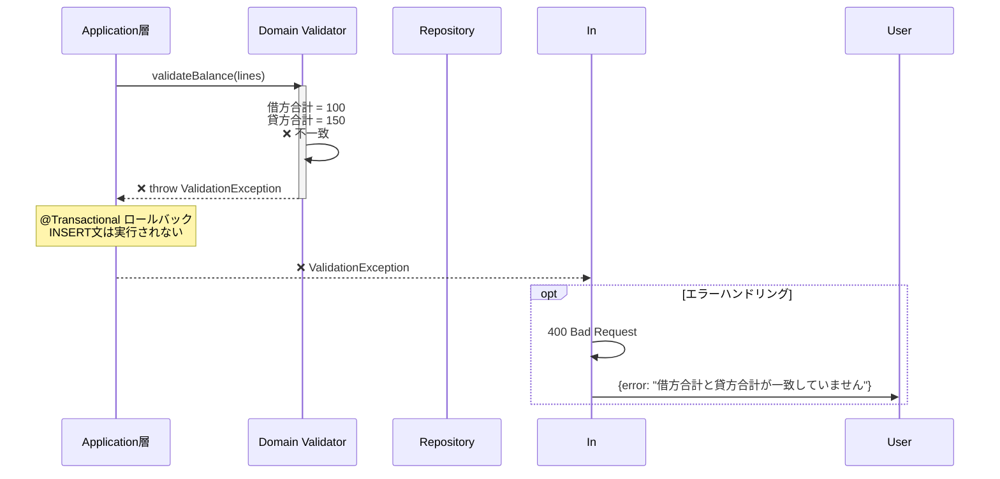

# アーキテクチャ詳細設計書（DDD/クリーンアーキテクチャ）

作成日：2026-11-17  
参照：`01-datamodel.md`, `02-api-design.md`

---

## 概要

会計システムはDDD（ドメイン駆動設計）+ クリーンアーキテクチャを採用。

**目的:**
- ドメイン（会計ロジック）を純粋に保つ
- 外部技術（HTTP, DB, キャッシュ）から独立
- ビジネスロジックの明確化
- テスト可能な設計

---

## 全体アーキテクチャ



---

## Bounded Context（ドメイン境界）

会計システムを以下に分割：

### Context 1: Journal（仕訳管理）

**責務:** 仕訳の作成・編集・削除・検索

**Domain Aggregate:**
- `JournalEntry` （仕訳）
- `JournalEntryLine` （仕訳行）
- `Amount` （金額：ValueObject）

**重要なビジネスルール:**
- 借方 = 貸方（貸借一致）
- メモは200文字以内
- 仕訳行は1件以上必須

---

### Context 2: Account（勘定科目管理）

**責務:** 勘定科目の登録・削除・一覧

**Domain Aggregate:**
- `Account` （勘定科目）
- `AccountCategory` （DEBIT/CREDIT：ValueObject）

**重要なビジネスルール:**
- コードはユニーク
- 使用中の勘定科目は削除不可
- 名前は20文字以内

---

## 層の構成と責務

### 1. 入力Adapter

**責務:** 外部からの入力を受け取る

```kotlin
// adapter/web/JournalEntryController.kt
@RestController
@RequestMapping("/api/journal-entries")
class JournalEntryController(
    private val createJournalEntryApplicationService: CreateJournalEntryApplicationService
) {
    @PostMapping
    fun create(@RequestBody request: CreateJournalEntryRequest): ResponseEntity<...> {
        // ① HTTP リクエストを受け取る
        // ② DTO → Command に変換
        val command = request.toCommand()
        
        // ③ Application層に仕事を指示
        val result = createJournalEntryApplicationService.execute(command)
        
        // ④ Domain → Response DTO に変換
        return ResponseEntity.status(HttpStatus.CREATED)
            .body(mapOf("data" to result.toResponse()))
    }
}
```

**ルール:**
- ✅ HTTP/CLI解析
- ✅ DTO ↔ Command変換
- ✅ 例外ハンドリング
- ❌ ビジネスロジック
- ❌ ドメイン知識

---

### 2. Application層（応用サービス）

**責務:** ユースケース（ビジネスプロセス）を調整

```kotlin
// application/journal/CreateJournalEntryApplicationService.kt
@Service
@Transactional
class CreateJournalEntryApplicationService(
    private val journalEntryRepository: JournalEntryRepository,
    private val journalEntryDomainService: JournalEntryDomainService
) {
    fun execute(command: CreateJournalEntryCommand): JournalEntryDTO {
        // ① ドメインに仕事を指示
        val validatedEntry = journalEntryDomainService.createAndValidate(command)
        
        // ② Repository に保存を指示
        val entryId = journalEntryRepository.insert(validatedEntry.entry)
        journalEntryRepository.insertLines(entryId, validatedEntry.lines)
        
        // ③ 結果を再取得
        val result = journalEntryRepository.findById(entryId)
            ?: throw NotFoundException("仕訳が見つかりません")
        
        return result.toDTO()
    }
}
```

**ルール:**
- ✅ トランザクション管理（`@Transactional`）
- ✅ ユースケースのフロー定義（「何をするか」）
- ✅ Domain と Repository を指揮
- ❌ 複雑なビジネスロジック
- ❌ SQL 直接実行
- ❌ ビジネスルール検証

---

### 3. Domain層（ドメイン）

**責務:** ビジネスロジック（「どうやるか」「何が正しいか」）

#### 3-1. Entity（エンティティ）

```kotlin
// domain/journal/JournalEntry.kt
data class JournalEntry(
    val id: Long? = null,
    val transactionDate: LocalDate,
    val memo: String? = null,
    val createdAt: LocalDateTime = LocalDateTime.now()
) {
    companion object {
        fun create(
            transactionDate: LocalDate,
            memo: String? = null
        ): JournalEntry {
            // ビジネスルール: メモは200文字以内
            require(memo == null || memo.length <= 200) {
                "メモは200文字以内です"
            }
            
            return JournalEntry(
                transactionDate = transactionDate,
                memo = memo
            )
        }
    }
}

// domain/journal/JournalEntryLine.kt
data class JournalEntryLine(
    val id: Long? = null,
    val journalEntryId: Long,
    val description: String? = null,
    val debitAccountId: Long? = null,
    val debitAmount: Amount? = null,
    val creditAccountId: Long? = null,
    val creditAmount: Amount? = null
) {
    companion object {
        fun create(
            journalEntryId: Long,
            description: String? = null,
            debitAccountId: Long? = null,
            debitAmount: Amount? = null,
            creditAccountId: Long? = null,
            creditAmount: Amount? = null
        ): JournalEntryLine {
            // ビジネスルール検証
            require(description == null || description.length <= 100) {
                "摘要は100文字以内です"
            }
            
            require((debitAccountId != null) == (debitAmount != null)) {
                "借方：勘定科目と金額は両方あるか、両方NULLか"
            }
            
            require((creditAccountId != null) == (creditAmount != null)) {
                "貸方：勘定科目と金額は両方あるか、両方NULLか"
            }
            
            return JournalEntryLine(
                journalEntryId = journalEntryId,
                description = description,
                debitAccountId = debitAccountId,
                debitAmount = debitAmount,
                creditAccountId = creditAccountId,
                creditAmount = creditAmount
            )
        }
    }
}
```

#### 3-2. ValueObject（値オブジェクト）

```kotlin
// domain/journal/Amount.kt
@JvmInline
value class Amount(val value: Int) {
    init {
        require(value > 0) { "金額は正の整数です" }
    }
}

// domain/account/AccountCategory.kt
enum class AccountCategory {
    DEBIT,    // 借方
    CREDIT    // 貸方
}
```

#### 3-3. DomainService（ドメインサービス）

```kotlin
// domain/journal/JournalEntryDomainService.kt
@Component
class JournalEntryDomainService {
    fun createAndValidate(command: CreateJournalEntryCommand): ValidatedJournalEntry {
        // ① Entity を作成（バリデーション入り）
        val entry = JournalEntry.create(
            transactionDate = command.transactionDate,
            memo = command.memo
        )
        
        // ② 仕訳行を作成（バリデーション入り）
        val lines = command.lines.map { lineCmd ->
            JournalEntryLine.create(
                journalEntryId = 0L,  // 仮ID
                description = lineCmd.description,
                debitAccountId = lineCmd.debitAccountId,
                debitAmount = lineCmd.debitAmount?.let { Amount(it) },
                creditAccountId = lineCmd.creditAccountId,
                creditAmount = lineCmd.creditAmount?.let { Amount(it) }
            )
        }
        
        // ③ ビジネスルール検証（複数Entity にまたがる）
        val validator = JournalEntryValidator()
        validator.validateBalance(lines)  // 貸借一致
        validator.validateLineCount(lines)  // 1件以上
        
        return ValidatedJournalEntry(
            entry = entry,
            lines = lines
        )
    }
}
```

#### 3-4. Validator（検証）

```kotlin
// domain/journal/JournalEntryValidator.kt
class JournalEntryValidator {
    fun validateBalance(lines: List<JournalEntryLine>) {
        val totalDebit = lines.mapNotNull { it.debitAmount }.sumOf { it.value }
        val totalCredit = lines.mapNotNull { it.creditAmount }.sumOf { it.value }
        
        require(totalDebit == totalCredit) {
            "借方合計($totalDebit)と貸方合計($totalCredit)が一致していません"
        }
    }
    
    fun validateLineCount(lines: List<JournalEntryLine>) {
        require(lines.isNotEmpty()) {
            "仕訳行は1件以上必要です"
        }
    }
}
```

#### 3-5. Repository Interface（インターフェース）

```kotlin
// domain/journal/JournalEntryRepository.kt
interface JournalEntryRepository {
    fun insert(entry: JournalEntry): Long
    fun insertLines(entryId: Long, lines: List<JournalEntryLine>)
    fun findById(id: Long): JournalEntryWithLines?
    fun findAll(): List<JournalEntry>
    fun delete(id: Long)
}
```

**Domain層のルール:**
- ✅ ビジネスルール検証
- ✅ Entity と ValueObject の定義
- ✅ DomainService（複数Entity にまたがるロジック）
- ✅ Validator（複雑な検証）
- ✅ Repository インターフェース（依存性逆転）
- ❌ SQL実行
- ❌ Spring依存（@Entity など）
- ❌ 外部ライブラリ依存
- ❌ Repository実装

---

### 4. 出力Adapter

**責務:** 外部リソースへの操作を実装

```kotlin
// adapter/persistence/JooqJournalEntryRepository.kt
@Repository
class JooqJournalEntryRepository(
    private val dsl: DSLContext
) : JournalEntryRepository {
    override fun insert(entry: JournalEntry): Long {
        // Domain → jOOQ 変換
        val result = dsl.insertInto(JOURNAL_ENTRIES)
            .set(JOURNAL_ENTRIES.TRANSACTION_DATE, entry.transactionDate)
            .set(JOURNAL_ENTRIES.MEMO, entry.memo)
            .returning(JOURNAL_ENTRIES.ID)
            .fetchOne()
        
        return result?.getValue(JOURNAL_ENTRIES.ID) 
            ?: throw Exception("Insert failed")
    }
    
    override fun insertLines(entryId: Long, lines: List<JournalEntryLine>) {
        lines.forEach { line ->
            dsl.insertInto(JOURNAL_ENTRY_LINES)
                .set(JOURNAL_ENTRY_LINES.JOURNAL_ENTRY_ID, entryId)
                .set(JOURNAL_ENTRY_LINES.DESCRIPTION, line.description)
                .set(JOURNAL_ENTRY_LINES.DEBIT_ACCOUNT_ID, line.debitAccountId)
                .set(JOURNAL_ENTRY_LINES.DEBIT_AMOUNT, line.debitAmount?.value)
                .set(JOURNAL_ENTRY_LINES.CREDIT_ACCOUNT_ID, line.creditAccountId)
                .set(JOURNAL_ENTRY_LINES.CREDIT_AMOUNT, line.creditAmount?.value)
                .execute()
        }
    }
}
```

**ルール:**
- ✅ Repository インターフェス実装
- ✅ SQL実行（jOOQ）
- ✅ Domain ↔ DB変換
- ❌ ビジネスロジック

---

## ファイル構造

```
src/main/kotlin/com/accounting/
│
├── adapter/
│   ├── inbound/                    ← 入力Adapter
│   │   ├── web/
│   │   │   ├── JournalEntryController.kt
│   │   │   ├── AccountController.kt
│   │   │   ├── dto/
│   │   │   │   ├── CreateJournalEntryRequest.kt
│   │   │   │   ├── CreateJournalEntryResponse.kt
│   │   │   │   └── ErrorResponse.kt
│   │   │   └── exception/
│   │   │       └── GlobalExceptionHandler.kt
│   │   │
│   │   └── cli/
│   │       └── JournalEntryCLIHandler.kt
│   │
│   └── outbound/                   ← 出力Adapter
│       ├── persistence/
│       │   ├── JooqJournalEntryRepository.kt
│       │   ├── JooqAccountRepository.kt
│       │   ├── JournalEntryWithLines.kt （取得時の DTO）
│       │   └── jooq/
│       │       └── （jOOQ生成クラス）
│       │
│       └── cache/
│           └── RedisJournalEntryCache.kt
│
├── application/
│   ├── journal/
│   │   ├── CreateJournalEntryApplicationService.kt
│   │   ├── EditJournalEntryApplicationService.kt
│   │   ├── DeleteJournalEntryApplicationService.kt
│   │   └── GetJournalEntriesApplicationService.kt
│   ├── account/
│   │   ├── CreateAccountApplicationService.kt
│   │   └── DeleteAccountApplicationService.kt
│   └── command/
│       ├── CreateJournalEntryCommand.kt
│       └── ...
│
├── domain/
│   ├── journal/
│   │   ├── JournalEntry.kt （Aggregate Root）
│   │   ├── JournalEntryLine.kt （Entity）
│   │   ├── Amount.kt （ValueObject）
│   │   ├── JournalEntryValidator.kt
│   │   ├── JournalEntryDomainService.kt
│   │   ├── JournalEntryRepository.kt （Interface）
│   │   └── ValidatedJournalEntry.kt （検証結果）
│   │
│   ├── account/
│   │   ├── Account.kt （Aggregate Root）
│   │   ├── AccountCategory.kt （ValueObject）
│   │   ├── AccountValidator.kt
│   │   └── AccountRepository.kt （Interface）
│   │
│   └── exception/
│       ├── ValidationException.kt
│       ├── ConflictException.kt
│       └── NotFoundException.kt
│
└── config/
    └── JooqConfig.kt
```

---

## 仕訳作成フロー（詳細シーケンス図）

### 全体フロー



---

### 層ごとの責務を見える化

| 層 | 仕事 | ⑧～⑩ |
|----|------|--------|
| **入力Adapter** | HTTP受け取り、DTO変換 | ① ②⑪ |
| **Application** | フロー調整、トランザクション | ② ③⑦⑧～⑩ |
| **Domain** | ビジネスルール検証 | ③～⑦ |
| **出力Adapter** | DB操作、Domain↔DB変換 | ⑧～⑩ |

---

### エラーケース：バリデーション失敗時



---

### エラーケース：貸借不一致時



---

## 依存関係の制御（重要）

### 依存方向

```
Adapter（web）→ Application → Domain ← Adapter（persistence）

重要ルール:
- Domain は何も知らない（独立している）
- Application は Domain と Adapter（Repository Interface）だけ知る
- Adapter は Application と Domain を知る
```

### 具体例

```kotlin
// ✅ 正しい依存関係
// Application → Domain（依存する）
class CreateJournalEntryApplicationService(
    private val journalEntryDomainService: JournalEntryDomainService  // Domain
)

// Domain は外部を知らない
class JournalEntry {
    // Spring import なし、Database import なし
    // pure Kotlin
}

// ❌ 間違った依存関係
// Domain → Application（依存してしまう）
class JournalEntry(
    private val applicationService: CreateJournalEntryApplicationService  // NG!
)

// Application が Adapter に依存
class CreateJournalEntryApplicationService(
    private val controller: JournalEntryController  // NG!
)
```

---

## テスト戦略

### Domain テスト（単体）

```kotlin
@Test
fun `メモが200文字を超える場合、例外`() {
    assertThrows<IllegalArgumentException> {
        JournalEntry.create(
            transactionDate = LocalDate.now(),
            memo = "a".repeat(201)
        )
    }
}
```

**特徴:**
- Pure Kotlin なので、Framework不要
- 高速実行
- 100% カバレッジ目標

### Application テスト（Usecase）

```kotlin
@Test
fun `仕訳作成フロー全体`() {
    val mockRepository = mockk<JournalEntryRepository>()
    every { mockRepository.insert(any()) } returns 1L
    every { mockRepository.insertLines(any(), any()) } returns Unit
    every { mockRepository.findById(1L) } returns mockEntry
    
    val service = CreateJournalEntryApplicationService(
        mockRepository,
        JournalEntryDomainService()
    )
    
    val result = service.execute(command)
    assertEquals(1L, result.id)
}
```

**特徴:**
- Repository を Mock
- DomainService は実物使用
- トランザクション検証

### Adapter テスト（統合）

```kotlin
@SpringBootTest
class JooqJournalEntryRepositoryTest {
    @Autowired
    private lateinit var repository: JooqJournalEntryRepository
    
    @Test
    fun `INSERT と SELECT が正しく動作`() {
        val entry = JournalEntry.create(LocalDate.now())
        val id = repository.insert(entry)
        
        val found = repository.findById(id)
        assertNotNull(found)
    }
}
```

**特徴:**
- H2 テストDB使用
- SQL検証
- N+1確認

---

## 実装ガイドライン（強制）

### Domain層で書いていいこと

```kotlin
✅ ビジネスルール検証
✅ Entity・ValueObject の定義
✅ DomainService（複数Entity にまたがるロジック）
✅ Validator
✅ Repository インターフェース定義
❌ SQL
❌ Spring アノテーション（@Entity, @Service など）
❌ 外部ライブラリ依存
❌ Repository実装
```

### Application層で書いていいこと

```kotlin
✅ Usecase フロー定義（「何をするか」）
✅ @Transactional（トランザクション管理）
✅ DomainService と Repository 呼び出し
✅ 複数 Repository の組み合わせ
❌ ビジネスルール検証（Domain がやる）
❌ SQL直接実行
❌ Repository実装
❌ DTO操作
```

### 入力Adapterで書いていいこと

```kotlin
✅ HTTP リクエスト/レスポンス処理（Controller）
✅ CLI 入力受け取り（CLIHandler）
✅ DTO ↔ Command 変換
✅ 例外ハンドリング
❌ ビジネスロジック
❌ ビジネスルール検証
❌ 複数の Application呼び出し調整
```

### 出力Adapterで書いていいこと

```kotlin
✅ Repository インターフェース実装（Persistence）
✅ SQL実行（jOOQ）
✅ キャッシュ実装（Redis等）
✅ ファイル出力、メール送信等
✅ Domain ↔ DB変換
❌ ビジネスロジック
❌ ビジネスルール検証
❌ Adapter同士の依存
```

---

## 層別レビューチェックリスト

### Domain追加・修正時

- [ ] Spring import がないか？
- [ ] Database import がないか？
- [ ] 外部依存がないか（pure Kotlin か）？
- [ ] ビジネスルール検証が入ってるか？
- [ ] テストが書きやすいか？

### Application追加・修正時

- [ ] @Transactional がついてるか？
- [ ] Domain と Repository だけ依存してるか？
- [ ] ビジネスロジックが Domain に逃げてないか？
- [ ] 1つのユースケースに限定されてるか？

### 入力Adapter追加・修正時

- [ ] HTTP/CLI 入力処理のみか？
- [ ] DTO → Command 変換が明確か？
- [ ] ビジネスロジックが入ってないか？
- [ ] 1つの Application呼び出しだけか？

### 出力Adapter追加・修正時

- [ ] Domain オブジェクトを受け取り・返してるか？
- [ ] SQL の複雑さは適切か？
- [ ] ビジネスロジックが入ってないか？
- [ ] 外部リソース操作のみか？

---

## 今後の拡張

**DDD ベースなので、以下が容易：**
- Bounded Context の追加（新ドメイン追加）
- DomainEvent の導入（イベントソーシング）
- Repository実装の切り替え（MySQL → PostgreSQL）
- キャッシング層の追加
- 非同期処理の追加

---

このアーキテクチャで、**責務が明確で、スケーラブルなシステム**が実現できます。
