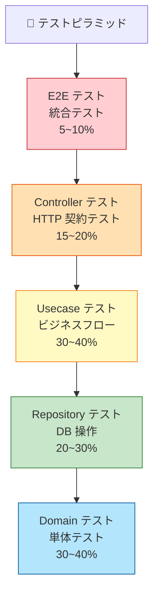

# テスト設計書

作成日：2026-11-16  
参照：`04-architecture.md`

## 概要

会計システムのテスト戦略。5層アーキテクチャの各層で異なるテスト手法を適用し、品質と保守性を両立させる。

---

## テスト戦略（ピラミッド型）



**ポイント:**
- **下部（Domain）が厚い** ← 単位テストが最も多い（速い、安定）
- **上部（E2E）が薄い** ← 統合テストは少ない（遅い、フラッキー）
- **中部（Usecase）が中心** ← ビジネスロジックをしっかり検証

---

## テスト層別設計

### 1. Domain テスト（単体テスト）

**対象:** `JournalEntry`, `JournalEntryLine`, `Amount`, `JournalEntryDomainService` などドメインクラス

**テストフレームワーク:** JUnit 5 + AssertJ

**責務:** ビジネスルールのバリデーションが機能するか

#### テストチェックリスト

**JournalEntry.create()**
- [ ] メモが null の場合、create 成功
- [ ] メモが 200 文字以内の場合、create 成功
- [ ] メモが 201 文字以上の場合、IllegalArgumentException
- [ ] 取引日が null の場合、NullPointerException
- [ ] 取引日が未来日でも create 成功（バリデーション不要）

**JournalEntryLine.create()**
- [ ] 借方金額が null、貸方金額が null の場合、create 成功（双方 null は OK）
- [ ] 借方金額が正の整数の場合、create 成功
- [ ] 借方金額が 0 の場合、IllegalArgumentException
- [ ] 借方金額が負の整数の場合、IllegalArgumentException
- [ ] 貸方金額が正の整数の場合、create 成功
- [ ] 貸方金額が 0 の場合、IllegalArgumentException
- [ ] 貸方金額が負の整数の場合、IllegalArgumentException
- [ ] 借方勘定科目 ID が null で借方金額が 100 の場合、IllegalArgumentException
- [ ] 借方勘定科目 ID が 1L で借方金額が null の場合、IllegalArgumentException
- [ ] 貸方勘定科目 ID が null で貸方金額が 100 の場合、IllegalArgumentException
- [ ] 貸方勘定科目 ID が 1L で貸方金額が null の場合、IllegalArgumentException
- [ ] 摘要が 100 文字以内の場合、create 成功
- [ ] 摘要が 101 文字以上の場合、IllegalArgumentException
- [ ] 摘要が null の場合、create 成功

**JournalEntryDomainService.validateBalance()**
- [ ] 借方合計 = 貸方合計の場合、検証成功
- [ ] 借方合計 > 貸方合計の場合、ValidationException
- [ ] 借方合計 < 貸方合計の場合、ValidationException
- [ ] 仕訳行が空の場合、ValidationException
- [ ] 仕訳行 1 件のみの場合、借貸が一致していれば成功

**Amount ValueObject（金額）**
- [ ] 正の整数で create 成功
- [ ] 0 で create 時に IllegalArgumentException
- [ ] 負の整数で create 時に IllegalArgumentException

**テストカバレッジ目標:** 100%（すべてのバリデーション ルールを検証）

---

### 2. Repository テスト（統合テスト + テストDB）

**対象:** `JournalEntryRepository`, `AccountRepository` など

**テストフレームワーク:** JUnit 5 + Spring Boot Test + H2 DB

**責務:** jOOQ が正しく SQL を生成し、DB が正しく応答するか

#### テストチェックリスト

**JournalEntryRepository.insert()**
- [ ] 仕訳を insert し、自動採番の ID が返される
- [ ] 返された ID で findById() すると元データが取得できる
- [ ] created_at, updated_at が自動設定されている

**JournalEntryRepository.insertLines()**
- [ ] 仕訳行を複数 insert できる
- [ ] 仕訳行が正しい journal_entry_id を持つ
- [ ] 仕訳行の自動採番 ID が各行で異なる

**JournalEntryRepository.findById()**
- [ ] 存在する仕訳 ID を検索すると仕訳データが返される
- [ ] 仕訳と仕訳行が1クエリで取得される（N+1 なし）
- [ ] LEFT JOIN で勘定科目情報も取得される
- [ ] 存在しない仕訳 ID を検索すると null が返される
- [ ] 仕訳行が複数ある場合、すべての行が返される

**JournalEntryRepository.findAll()**
- [ ] 全仕訳を取得できる
- [ ] 取引日の降順でソートされている
- [ ] 同一日付の場合は ID の降順
- [ ] 各仕訳の行も LEFT JOIN で取得されている
- [ ] 仕訳がない場合、空リストが返される

**JournalEntryRepository.update()**
- [ ] 仕訳のメモと取引日が更新される
- [ ] updated_at が更新される
- [ ] 存在しない ID で更新すると 0 件更新

**JournalEntryRepository.delete()**
- [ ] 仕訳を削除できる
- [ ] 仕訳削除時、その仕訳行も自動削除される（ON DELETE CASCADE）
- [ ] 存在しない ID で削除しても例外が発生しない

**JournalEntryRepository.deleteLines()**
- [ ] 指定した journal_entry_id の仕訳行をすべて削除
- [ ] 削除後 findById() で行が 0 件になっている

**AccountRepository.insert()**
- [ ] 勘定科目を insert し、自動採番の ID が返される
- [ ] code, name, account_category が正しく保存される
- [ ] created_at, updated_at が自動設定されている

**AccountRepository.findById()**
- [ ] 存在する勘定科目 ID を検索するとデータが返される
- [ ] 存在しない勘定科目 ID を検索すると null が返される

**AccountRepository.findByCode()**
- [ ] code で勘定科目を検索できる
- [ ] 存在しない code で検索すると null が返される

**AccountRepository.findAll()**
- [ ] 全勘定科目を取得できる
- [ ] 勘定科目がない場合、空リストが返される

**AccountRepository.delete()**
- [ ] 勘定科目を削除できる
- [ ] その勘定科目が仕訳行で使用中の場合、削除不可（外部キー制約違反）
- [ ] 存在しない ID で削除しても例外が発生しない

**AccountRepository.checkIfUsed()**
- [ ] その勘定科目が仕訳行で使用中の場合、true が返される
- [ ] 未使用の場合、false が返される

**外部キー・制約テスト**
- [ ] 存在しない account_id を持つ仕訳行を insert すると外部キー制約違反
- [ ] 重複する code で勘定科目を insert するとユニーク制約違反

**テストカバレッジ目標:** 80%（主要パスを検証）

---

### 3. Usecase テスト（ビジネスロジック）

**対象:** `CreateJournalEntryUsecase`, `UpdateJournalEntryUsecase`, `DeleteJournalEntryUsecase`, `CreateAccountUsecase`, `DeleteAccountUsecase` など

**テストフレームワーク:** JUnit 5 + Mockito

**責務:** ビジネスプロセス（Usecase が何をするか）が正しいか

#### テストチェックリスト

**CreateJournalEntryUsecase**
- [ ] 有効な仕訳コマンドで create 成功
- [ ] メモが 200 文字超の場合、ValidationException
- [ ] 仕訳行が空の場合、ValidationException
- [ ] 借方合計と貸方合計が不一致の場合、ValidationException
- [ ] 勘定科目 ID が存在しない場合、ValidationException
- [ ] create 成功時、insert → insertLines → findById の順序で実行
- [ ] insert 後、insertLines で複数の行が一括登録される
- [ ] 返却値には id, transactionDate, memo, lines が含まれる

**UpdateJournalEntryUsecase**
- [ ] 有効な仕訳コマンドで update 成功
- [ ] 更新対象の仕訳が存在しない場合、NotFoundException
- [ ] メモが 200 文字超の場合、ValidationException
- [ ] 仕訳行が空の場合、ValidationException
- [ ] 借方合計と貸方合計が不一致の場合、ValidationException
- [ ] update 時、既存の仕訳行をすべて削除してから新規追加（全置換）
- [ ] 返却値が更新後の仕訳データを含む

**DeleteJournalEntryUsecase**
- [ ] 有効な仕訳 ID で delete 成功
- [ ] 削除対象の仕訳が存在しない場合、NotFoundException
- [ ] 削除時に仕訳行も自動削除される（CASCADE）

**CreateAccountUsecase**
- [ ] 有効な勘定科目コマンドで create 成功
- [ ] code, name, account_category が正しく保存される
- [ ] 重複する code の場合、ConflictException
- [ ] code が 20 文字超の場合、ValidationException
- [ ] name が 20 文字超の場合、ValidationException
- [ ] account_category が DEBIT でも CREDIT でもない場合、ValidationException
- [ ] 返却値に id, code, name, account_category が含まれる

**DeleteAccountUsecase**
- [ ] 未使用の勘定科目は削除成功
- [ ] 仕訳で使用中の勘定科目は削除不可（ConflictException）
- [ ] 削除対象の勘定科目が存在しない場合、NotFoundException

**全 Usecase 共通**
- [ ] トランザクション外での呼び出しは失敗（@Transactional 検証）
- [ ] ビジネスロジックエラーは予期された例外型で throw
- [ ] 予期しないエラーは RuntimeException でラップ

**テストカバレッジ目標:** 75%（主要フロー + エラーケース）

---

### 4. Controller テスト（HTTP 契約）

**対象:** `JournalEntryController`, `AccountController` など

**テストフレームワーク:** JUnit 5 + Spring Boot Test + MockMvc

**責務:** HTTP リクエスト/レスポンスが仕様通りか

#### テストチェックリスト

**POST /api/journal-entries（仕訳登録）**
- [ ] 有効なリクエストで 201 Created を返す
- [ ] レスポンスに id, transactionDate, memo, lines が含まれる
- [ ] レスポンスに createdAt が含まれる
- [ ] transactionDate が「YYYY-MM-DD」形式
- [ ] memo が null の場合でも受け付ける
- [ ] transactionDate が無効な日付の場合、400 Bad Request
- [ ] lines が空配列の場合、400 Bad Request
- [ ] lines 内のいずれかが無効な場合、400 Bad Request（fields に該当行の情報）
- [ ] 借方合計と貸方合計が不一致の場合、400 Bad Request
- [ ] 勘定科目 ID が存在しない場合、400 Bad Request
- [ ] JSON 形式が無効な場合、400 Bad Request

**GET /api/journal-entries（仕訳一覧）**
- [ ] 200 OK を返す
- [ ] レスポンスが配列（data は array）
- [ ] 各仕訳に id, transactionDate, memo, lines, createdAt が含まれる
- [ ] 仕訳行が複数の場合、すべて返される
- [ ] 仕訳がない場合、空配列を返す
- [ ] 取引日の降順でソートされている

**GET /api/journal-entries/{id}（仕訳詳細）**
- [ ] 有効な仕訳 ID で 200 OK を返す
- [ ] 返却データが POST レスポンスと同じ形式
- [ ] 存在しない仕訳 ID で 404 Not Found を返す
- [ ] パスパラメータが数字でない場合、400 Bad Request

**PUT /api/journal-entries/{id}（仕訳編集）**
- [ ] 有効な仕訳 ID と有効なリクエストで 200 OK を返す
- [ ] 返却データが更新後の仕訳
- [ ] 存在しない仕訳 ID で 404 Not Found を返す
- [ ] リクエストボディが無効な場合、400 Bad Request
- [ ] 借方合計と貸方合計が不一致の場合、400 Bad Request

**DELETE /api/journal-entries/{id}（仕訳削除）**
- [ ] 有効な仕訳 ID で 200 OK を返す
- [ ] レスポンスに削除された仕訳 ID が含まれる
- [ ] 存在しない仕訳 ID で 404 Not Found を返す

**POST /api/accounts（勘定科目登録）**
- [ ] 有効なリクエストで 201 Created を返す
- [ ] レスポンスに id, code, name, accountCategory, createdAt が含まれる
- [ ] code が 20 文字超の場合、400 Bad Request
- [ ] name が 20 文字超の場合、400 Bad Request
- [ ] accountCategory が DEBIT でも CREDIT でもない場合、400 Bad Request
- [ ] 重複する code で登録した場合、409 Conflict を返す
- [ ] code, name が必須の場合、400 Bad Request

**GET /api/accounts（勘定科目一覧）**
- [ ] 200 OK を返す
- [ ] レスポンスが配列（data は array）
- [ ] 各勘定科目に id, code, name, accountCategory, createdAt が含まれる
- [ ] 勘定科目がない場合、空配列を返す

**DELETE /api/accounts/{id}（勘定科目削除）**
- [ ] 未使用の勘定科目で 200 OK を返す
- [ ] レスポンスに削除された勘定科目 ID が含まれる
- [ ] 仕訳で使用中の勘定科目で 409 Conflict を返す
- [ ] 存在しない勘定科目 ID で 404 Not Found を返す

**全 Controller 共通**
- [ ] 予期しないエラーで 500 Internal Server Error を返す
- [ ] エラーレスポンスが { error: { code, message } } 形式
- [ ] ビジネスロジックエラー（409等）のエラーメッセージはユーザーが理解できる内容

**テストカバレッジ目標:** 60%（主要エンドポイント + エラーケース）

---

### 5. E2E テスト（統合テスト）

**対象:** 全体のビジネスフロー

**テストフレームワーク:** JUnit 5 + Spring Boot Test（実 DB または Testcontainers）

**責務:** 仕訳作成～削除の一連フローが正しいか（すべてが連携しているか）

#### テストチェックリスト

**仕訳ドメイン全体フロー**
- [ ] 勘定科目作成 → 仕訳作成 → 仕訳取得 → データが正しく返される
- [ ] 仕訳作成 → 仕訳編集 → 編集後のデータが反映されている
- [ ] 仕訳作成 → 仕訳削除 → 削除後は 404
- [ ] 複数の仕訳を作成 → 一覧で全件取得できる
- [ ] 複数の仕訳を作成 → 一覧で取引日降順でソートされている

**勘定科目ドメイン全体フロー**
- [ ] 勘定科目作成 → 一覧取得 → 作成した勘定科目が含まれる
- [ ] 未使用の勘定科目を削除 → 削除成功
- [ ] 仕訳で使用中の勘定科目を削除 → 409 Conflict
- [ ] 複数の勘定科目を作成 → 一覧で全件取得できる

**複雑なビジネスシナリオ**
- [ ] 勘定科目を複数作成 → 複数の勘定科目を使った仕訳を作成 → 仕訳一覧で全勘定科目情報が返される
- [ ] 仕訳作成 → 仕訳編集（勘定科目変更） → 編集後の仕訳行が正しい
- [ ] 仕訳作成 → 仕訳編集（行の追加） → 行数が増えている
- [ ] 仕訳作成 → 仕訳編集（行の削除） → 行数が減っている
- [ ] 仕訳作成（複数行） → 仕訳削除 → すべての行が削除されている

**エラーハンドリングE2E**
- [ ] 存在しない勘定科目 ID で仕訳作成を試みる → 400 Bad Request
- [ ] 借貸不一致の仕訳を作成しようとする → 400 Bad Request
- [ ] 仕訳作成前に仕訳 ID で get を試みる → 404 Not Found
- [ ] 存在しない勘定科目 ID で削除を試みる → 404 Not Found
- [ ] 同じ code で勘定科目を 2 回作成 → 2 番目は 409 Conflict

**データ整合性テスト**
- [ ] 勘定科目削除時に外部キー制約が働いているか（DELETE RESTRICT）
- [ ] 仕訳削除時に仕訳行が自動削除されるか（ON DELETE CASCADE）
- [ ] トランザクション中の複数操作（insert → insert → find）が1トランザクション内で実行されるか

**テストカバレッジ目標:** 80%（全ユースケースの主要パス）

---

## テストデータ管理

### FixtureBuilder パターン

```kotlin
class JournalEntryFixture {
  companion object {
    fun defaultJournalEntry() = JournalEntry.create(
      transactionDate = LocalDate.of(2026, 11, 13),
      memo = "デフォルトメモ"
    )
    
    fun defaultLine(
      debitAccountId: Long = 1L,
      debitAmount: Int = 100,
      creditAccountId: Long = 2L,
      creditAmount: Int = 100
    ) = JournalEntryLine.create(
      journalEntryId = 1L,
      debitAccountId = debitAccountId,
      debitAmount = debitAmount,
      creditAccountId = creditAccountId,
      creditAmount = creditAmount
    )
  }
}

// 使用時
val entry = JournalEntryFixture.defaultJournalEntry()
val line = JournalEntryFixture.defaultLine(debitAmount = 500)
```

### テスト DB の初期化（H2）

```yaml
# application-test.properties
spring.datasource.url=jdbc:h2:mem:test
spring.datasource.driver-class-name=org.h2.Driver
spring.jpa.database-platform=org.hibernate.dialect.H2Dialect
spring.jpa.hibernate.ddl-auto=create-drop
spring.flyway.enabled=true
```

---

## テスト実行戦略

### ローカル開発

```bash
# 全テスト実行
./gradlew test

# Domain テストのみ
./gradlew test --tests "*Domain*"

# Usecase テストのみ
./gradlew test --tests "*Usecase*"

# カバレッジレポート生成
./gradlew test jacocoTestReport
# build/reports/jacoco/test/html/index.html
```

### CI/CD パイプライン

```yaml
# GitHub Actions / GitLab CI
stages:
  - test:domain    # 実行時間: 10秒
  - test:repository  # 実行時間: 20秒
  - test:usecase     # 実行時間: 15秒
  - test:controller  # 実行時間: 15秒
  - test:e2e         # 実行時間: 30秒（オプション）
  - coverage-check   # カバレッジが75%以上か確認
```

---

## テストカバレッジ目標

| 層 | 目標 | 理由 |
|---|------|------|
| Domain | 100% | ビジネスルールが完全に検証されるべき |
| Repository | 80% | SQL の標準的なケースをカバー |
| Usecase | 75% | ビジネスフロー + エラーケース |
| Controller | 60% | HTTP 契約の最重要ケース |
| **全体** | **75%** | プロダクションコード全体 |

---

## テスト実装のガイドライン

### DO（やること）

- ✅ テストメソッド名は日本語で「～の場合、～」と明記
- ✅ 1テストは1つのことだけをテスト
- ✅ Arrange-Act-Assert パターン（準備-実行-検証）
- ✅ mock は必要最小限
- ✅ テスト用 fixture を活用

### DON'T（やらないこと）

- ❌ テストが本体より複雑
- ❌ DB に依存する単体テスト（Domain は pure）
- ❌ sleep() で時間を稼ぐ（不安定になる）
- ❌ テスト同士が依存（各テストが独立）
- ❌ 「動けば OK」という不十分な検証

---

## 今後の拡張

- **パフォーマンステスト** — 仕訳1000件以上で応答時間測定
- **セキュリティテスト** — 認証・認可が実装されたら追加
- **負荷テスト** — 並行アクセス時の動作確認
- **プロパティテスト** — QuickCheck/Kotest で仕様を自動検証
